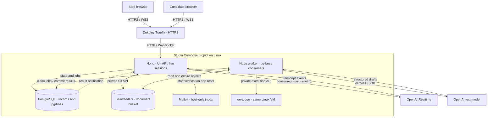
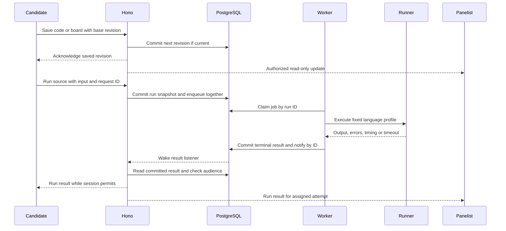
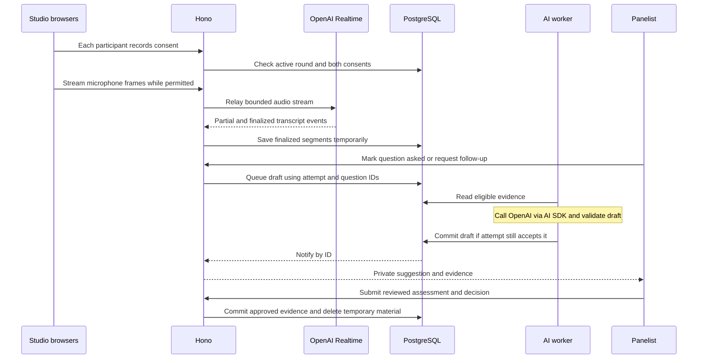

# Interview Studio v1 architecture

## Design target

Deploy Interview Studio as a Docker Compose project on the Linux server that already runs Dokploy. The [product plan](product-plan.md) defines the roles and interview workflow.

Staff and candidates use the deployed HTTPS address from supported browsers. Local development uses Docker Compose on the Mac. Use Mac and Windows browsers to test microphone permissions, session isolation, reconnects, and Teams audio. The inspected M5 Pro has 48 GiB RAM and about 7.7 GiB assigned to Docker. Measure deployment capacity on the Linux host.

## Services and connections

Hono serves the built React application, HTTP API, and live connections from one origin. A worker from the same image handles durable jobs. PostgreSQL stores interview records and queue state. A private S3-compatible bucket stores original uploads. This keeps the interview functional during an AI outage and gives a restarted browser or process a place to recover its state.

| Service | Responsibilities and reachability |
| --- | --- |
| Dokploy ingress | The existing Traefik proxy terminates TLS and forwards HTTP and WebSocket upgrades to Hono. This proxy belongs to Dokploy. |
| App | Authenticate, serve UI assets, enforce workflow rules, authorize reads and writes, accept work revisions, and relay consented audio. Reachable through the configured Dokploy domain. |
| Worker | Run a Node process from the application image using pg-boss to claim jobs in PostgreSQL. Process document intake, AI drafts, code runs, and expiry. Give live interview jobs their own bounded capacity so a resume batch cannot occupy every worker slot. |
| PostgreSQL | Store application data, sessions, and the pg-boss queues in a persistent volume. Accessible to app and worker on the private network. |
| SeaweedFS | Serve the private document bucket over the S3 API. Persist the SeaweedFS data directory in its own Docker volume. Only the storage service mounts that volume. |
| Runner | Execute a single submitted program at a time in a fresh sandbox. For the pilot, run go-judge as a Compose service on the existing Dokploy VM. Only the worker joins its internal control network alongside it. Give the runner zero published ports and no Dokploy domain. |
| Mailpit | Capture staff verification and reset emails locally using SMTP. Bind its inbox to host loopback. Use SSH port forwarding for operator access during testing. Configure an approved SMTP relay for delivery to actual staff mailboxes. HR shares candidate invitations through existing channels. |

Use a one-shot migration command before starting the app and worker. Gate startup on database readiness and successful migrations. Provide an idempotent seed command for synthetic staff, a drive, resumes, and bookings. Run the same Compose services locally for development, with Vite+ hot reload and same-origin proxying. On Linux, create a Docker Compose resource in Dokploy, configure the app's stable HTTPS origin for cookies and invitations, and route that domain to the internal Hono service port (3000). Point DNS at the server and use a certificate trusted by client browsers. Redeploy after changing the domain. Check the Compose preview so only the app receives ingress and the runner stays on its private network. Verify that the deployed origin supports WebSocket upgrades and browser microphone permissions. [Dokploy Compose domains](https://docs.dokploy.com/docs/core/docker-compose/domains)

### Private file storage

Use single-node **SeaweedFS** behind an S3 interface for PDF and DOCX resumes and job descriptions. Run its all-in-one service with a persistent data directory, a private bucket, and authenticated access. Only the S3 listener should be reachable by app and worker. Bind the filer, admin UI, and other management interfaces to loopback or otherwise restrict them to operators. Publish no storage ports through Dokploy. Provision separate bucket-scoped service credentials outside the repository and reject anonymous reads, writes, and listing. [SeaweedFS setup](https://github.com/seaweedfs/seaweedfs) · [S3 credentials](https://github.com/seaweedfs/seaweedfs/wiki/S3-Credentials)

Use the AWS SDK for JavaScript v3 with configurable endpoint, region, bucket, credentials, and path-style addressing. Hono authorizes an upload or download against the drive or candidacy and streams its bytes. The worker retrieves originals for extraction and deletes expired objects. Give the app read/write access and the worker the read/delete permissions its tasks require. Store an opaque object key, original filename, declared and validated type, size, SHA-256 checksum, owner, and intake status in PostgreSQL. Keep code, run results, and whiteboard revisions in PostgreSQL. Microphone audio remains transient.

Create a pending document record before upload. Mark it ready and enqueue extraction together after the object write succeeds. Expire incomplete uploads and retry failed deletions by key. Validate the permitted formats and size, bound DOCX decompression and parsing resources, and serve authorized originals as downloads. The browser never receives storage credentials.

**Backup and recovery.** For the deployed pilot, store PostgreSQL base backups, its write-ahead log (WAL), and object backups in a separate failure domain under the same retention policy. Require durable off-host WAL confirmation before acknowledging access changes, assessment submissions or corrections, and retention deletions. This preserves the approved evidence and the deletion or revocation in the same transaction history.

Restore with ingress, workers, and provider calls disabled. Replay through the latest acknowledged changes before running expiry against the current time. Reconcile restored objects against live document records, remove expired or deleted objects, and verify a retained download by checksum. After reconciliation, use an isolated worker to retry a stale job with provider calls disabled. Before reopening, verify denial of a revoked invitation and session, survival of approved evidence, and absence of deleted content. Keep the instance offline if the required WAL or evidence is missing.

**Storage portability.** To move providers, pause document writes and expiry jobs, copy objects preserving keys, verify the inventory and checksums, switch endpoint settings, and test authorized retrieval and anonymous denial before resuming. Application records contain logical keys, so moving a bucket requires no URL rewrite. [AWS S3 client](https://docs.aws.amazon.com/AWSJavaScriptSDK/v3/latest/client/s3/)

## Technology choices

Versions below capture the 25 November 2026 research baseline. Pin direct dependencies and commit the pnpm lockfile. Record tested image digests for Mac ARM64 and the Linux host architecture and runner toolchain builds after the feasibility checks. Vite+ supplies its compatible Vite and Vitest versions.

| Area | Choice | Application |
| --- | --- | --- |
| Runtime and workspace | Node.js 26.13.1 LTS, TypeScript 7.0.2, pnpm 12.23.0, Vite+ 1.8.0, Biome 2.6.9 | One pnpm workspace. Use Vite+ for development, builds, and tests. Commit biome.json and use Biome for supported formatting and linting. Disable overlapping Vite+ checks and run TypeScript checking explicitly. [Vite+](https://viteplus.dev/) · [Check settings](https://viteplus.dev/config/check) · [Node releases](https://nodejs.org/en/about/previous-releases) |
| Frontend | React and React DOM 19.3.1, TanStack Router 1.170.46 | Typed routes for drives and rounds. Keep reporting filters in URL search parameters. Hono already provides the server required by the live workspace, so the UI can ship as static assets. [TanStack Router](https://tanstack.com/router/latest) |
| Components and forms | shadcn CLI 4.23.0 with Base UI 1.9.0 primitives, Tailwind CSS 4.3.5, React Hook Form 7.92.0, resolvers 7.0.9, Zod 4.6.7 | Own the generated component source. Validate inputs in both forms and Hono. Start with CSS transitions and reduced-motion support. Motion 14.14.0 is a deferred option for a demonstrated interaction need. [shadcn forms](https://ui.shadcn.com/docs/forms/react-hook-form) · [Zod](https://zod.dev/) |
| State | TanStack Query 5.108.4, Zustand 5.1.0 | Query caches server data. A per-round, in-memory Zustand store tracks shared UI state such as connection and save status. Editor buffers and scenes stay with their editors. Clear session-scoped caches and stores on exit or identity change. [TanStack Query](https://tanstack.com/query/latest/docs/framework/react/overview) · [Zustand](https://zustand.docs.pmnd.rs/) |
| Transport | Hono 4.13.22, @hono/node-server 2.1.11, ws 8.23.0 | One HTTP origin for business actions, a WebSocket for live events, and a bounded binary audio channel. The Node adapter supports upgrades directly. [Hono on Node](https://hono.dev/docs/getting-started/nodejs) |
| Storage and jobs | PostgreSQL 19.0, Drizzle ORM 0.45.4, Drizzle Kit 0.31.11, pg 8.23.1, pg-boss 12.39.0 | Reviewed SQL migrations, transactional decisions, retryable jobs, and indexed dashboard queries in the same database. [PostgreSQL 19](https://www.postgresql.org/about/news/postgresql-19-released-3449/) · [Drizzle](https://orm.drizzle.team/docs/get-started-postgresql) · [pg-boss](https://github.com/timgit/pg-boss) |
| Staff identity and email | Better Auth 1.7.28 and matching Drizzle adapter, Nodemailer 10.6.1, Mailpit 1.34.0 | Verified email, password reset, secure sessions, and local SMTP. Studio owns roles and round assignment. [Better Auth with Hono](https://better-auth.com/docs/integrations/hono) · [Mailpit](https://mailpit.axllent.org/) |
| Object storage | SeaweedFS 4.55, @aws-sdk/client-s3 3.1177.0 | An S3 endpoint for original files in local and deployed environments. Pin the tested image digest and client release. [SeaweedFS releases](https://github.com/seaweedfs/seaweedfs/releases) · [S3 client release](https://registry.npmjs.org/@aws-sdk/client-s3/3.1177.0) |
| Documents | PDF.js pdfjs-dist 6.5.438, Mammoth 1.13.0 | Extract plain text from PDF and DOCX. Bound upload size and parsing time. Store originals outside the web root and authorize downloads. HR can recover a scan or parsing failure by manual entry. [PDF.js](https://github.com/mozilla/pdf.js) · [Mammoth](https://github.com/mwilliamson/mammoth.js) |
| Interview tools | CodeMirror 6 with JavaScript, Python, and Java language extensions, Excalidraw 0.18.1 | Lazy-load both tools on the interview route. Serve drawing assets locally. Use one editable candidate workspace and a panelist read-only view. [CodeMirror](https://codemirror.net/docs/) · [Excalidraw](https://github.com/excalidraw/excalidraw) |
| Code runner | go-judge 1.14.1, Node 26 LTS, Python 3.15.2, Temurin JDK 25 LTS | Build a runner image for each host architecture containing all three toolchains. Configure fixed language profiles and separate Java compile and run budgets. [go-judge](https://github.com/criyle/go-judge) · [Python releases](https://www.python.org/getit/source/) · [Temurin](https://adoptium.net/temurin/releases/) |
| Hosted AI | Vercel AI SDK 7.0.181, @ai-sdk/openai 4.0.123, OpenAI Realtime transcription | Start with gpt-6-luna for structured text tasks and gpt-live-transcribe for live speech. Configure the IDs independently and verify access with the configured account. Only backend processes receive provider credentials. [AI SDK OpenAI provider](https://ai-sdk.dev/providers/ai-sdk-providers/openai) · [Text model](https://developers.openai.com/api/docs/models/gpt-6-luna) · [Realtime transcription](https://developers.openai.com/api/docs/guides/realtime-transcription) |
| Local operations and tests | Dokploy-managed Traefik, Pino 10.4.0, Vite+-managed Vitest 5.1.1, Playwright 1.65.1 | Log IDs, status, timing, and error class. Exclude tokens, credentials, attachments, code, audio, transcripts, and prompts. Test roles in independent browser contexts. [Vite+ release metadata](https://registry.npmjs.org/vite-plus/1.8.0) · [Playwright contexts](https://playwright.dev/docs/browser-contexts) |

## Modules, access, and stored records

Use `apps/web` for React, `apps/server` for Hono and the worker entry point, and `packages/contracts` for Zod request, response, and live-event schemas. Keep authorization, state transitions, and migrations in the server. Group HTTP endpoints under `/api` by identity, drives, candidacies, scheduling, interviews, assessments, and reporting. Admit authenticated connections to `/live` after checking the session, origin, and attempt. Validate permitted actions and audience on each event.

| Record group | Ownership and lifecycle |
| --- | --- |
| Staff and access | Verify an approved email domain and mailbox before activation. The predesignated verified address becomes the first director. Directors manage roles. HR coordinates all drives. Panelists receive only assigned rounds, including submitted L1 feedback when assigned L2. |
| Drive and candidacy | A drive owns the JD, reviewed L1/L2 criteria, and its candidate records. Keep candidate identity scoped to the drive. HR resolves duplicates and confirms name and email before scheduling. Freeze the criteria evaluated by each attempt so a later edit cannot change prior feedback. |
| Booking, invitation, and attempt | Store UTC instants and the display time zone. On booking and rescheduling, compare overlapping UTC intervals across drives by trimmed, lowercased confirmed candidate email or panelist ID. Exclude the booking being edited and cancelled slots. Return an advisory warning to HR. Keep candidacy IDs and outcome queries drive-scoped. Track round level, attempt number, admission, revocation, and lifecycle separately. Generate a fresh link for a new or rescheduled attempt. |
| Interview evidence | Keep current code and scene revisions, immutable run snapshots, asked questions, notes, consent history, and temporary transcript segments. Only the candidate writes workspace artifacts. Panelist observations and AI drafts have a staff-only audience. |
| Assessment and reporting | Retain approved excerpts with attribution and references to the relevant question and skill. Bind each artifact citation to an immutable code or drawing revision in the same attempt. Preserve the revision while a draft cites it and for the lifetime of any submitted assessment version that cites it. Authorize reads through the assessment and resolve the stored revision ID. Store ratings, rationale, author, and submission time. Corrections append a version with a reason. Report the current candidacy once per drive and retain prior attempts for drill-down. |

Use a high-entropy invitation secret, store its hash, and submit the secret and matching email to Hono over HTTPS. Keep the secret out of request logs and strip it from the browser URL after exchange. Issue a secure, HTTP-only, round-scoped candidate session. Apply the 10-minute early-entry and scheduled-end rules to first admission. An admitted candidate waits for the panelist to start and may reconnect during overtime while active. Cancellation, replacement, no-show, withdrawal, or closure revokes the affected access, including existing sessions and sockets. Reassignment removes the previous panelist's access. Browser navigation and disconnects leave the attempt active.

## Interview and job data flows

**Saving and reconnecting.** Debounce workspace snapshots. Acknowledge after commit. Reject a stale write from another tab and reload the current revision before resuming. If the candidate ends the round, flush their pending edits before confirmation. If a panelist or HR closes remotely, make the last acknowledged revision visible and authoritative. Closing atomically blocks further candidate writes and reads. A reconnect fetches current authorized state and outstanding run results from the API.

**Returning worker results.** Enqueue the job in the same database transaction as the business record, using the transaction-aware pg-boss integration. Jobs carry record IDs. Make consumers idempotent and distinguish a retried submission from a new attempt. Commit the result and an ID-only PostgreSQL notification together. Hono maintains a dedicated listener, reloads committed data, and sends audience-specific events. Recover from missed notifications with a snapshot on reconnection and periodic status refetch while a job is pending. This works for both code results and private AI suggestions. [PostgreSQL notifications](https://www.postgresql.org/docs/current/sql-notify.html)

**Pilot execution on the existing Linux VM.** Enable code execution for trusted internal pilot sessions with synthetic data. Check the round’s execution setting on the server before queuing a run and again in the worker before dispatch. Run one program at a time. Give each submission temporary storage, a fixed language profile, and enforced CPU, wall-time, memory, process-count, and output limits. Block program network access. Scope elevated container privileges to go-judge and keep the Docker socket, host data mounts, application secrets, and cloud credentials out of its configuration.

The runner shares the Linux kernel with Dokploy, PostgreSQL, and SeaweedFS. A compromise of the privileged runner could expose the whole VM. Verify cgroup enforcement and network isolation on this host with all three languages before enabling runs. If checks fail, disable execution and keep editing, saving, and manual assessment available. Record the manual workflow milestone independently. Full pilot sign-off requires passing isolation, success, error, and timeout checks in JavaScript, Python, and Java, plus the live Java rehearsal in milestone 4. [go-judge requirements](https://github.com/criyle/go-judge)

**After the pilot.** Revisit a dedicated runner VM before opening execution to untrusted submissions. Keep the runner endpoint in worker configuration so a future move changes the address and connection credentials while preserving the browser API, job format, and saved results.

**Intake and preparation.** HR uploads the JD and resumes. The worker reads originals, extracts text, requests schema-validated draft records and role-specific questions, and saves them for review. Report status per file so a failed extraction leaves the rest of the batch usable. Treat document and interview content as untrusted model input. Restrict model output to draft fields and validate evidence IDs against the current attempt.

### Audio, AI feedback, and deletion

- **Capture.** Use browser microphone capture and an AudioWorklet to produce the format required by the transcription session. Virtual interviews use one authenticated, timestamped stream per participant. An in-person interview has one designated shared microphone. A virtual stream identifies the device owner. Echo or uncertain speakers still require human review. Use headphones during the two-device virtual pilot.
- **Interruptions.** Limit in-memory audio buffering, show connection loss, and mark gaps rather than silently replaying stale audio. Keep partial text in memory and deduplicate finalized events on reconnect. Tie capture on both devices to a short-lived server authorization renewed by control-channel heartbeats from both participants. On a detected disconnect, or when a heartbeat deadline expires during a silent partition, Hono invalidates that capture session and closes its upstream streams. Each browser stops its microphone tracks on local connection loss, authorization expiry, or a server stop event. Clear pending audio, reject late frames from that session, and display the actual capture state. Withdrawal and round closure use the same stop path. After a disconnect, issue a new capture session only after both participants agree again and the server confirms the attempt is active. The interview itself can continue manually.
- **Drafts.** Generate follow-ups at question boundaries or on request. Base feedback on questions actually asked, including panelist additions. Show suggestions only to the assigned panelist. Carry approved unresolved L1 evidence forward to the assigned L2 panelist. Ratings and decisions are entered by the panelist. Provider errors leave manual notes and submission available.
- **Retention.** On submission, atomically copy approved evidence into the assessment, append the decision, and delete the full temporary transcript and every unapproved transcript-derived draft, including dismissed and untouched suggestions. Fence late jobs against recreating deleted content. Apply configurable expiry to abandoned material and completed records, including private uploads when no longer referenced. Keep audio in memory only. Set Responses storage to false for text requests. The organization’s provider approver records the deployed account settings, applicable terms, and deletion timing separately for text and speech. Verify this record before the full pilot rehearsal and before sending real resumes or interview data to either provider. Feasibility calls use synthetic fixtures. [OpenAI data controls](https://developers.openai.com/api/docs/guides/your-data)

Closing an interview and submitting an assessment are distinct actions. Closure moves the attempt to **Awaiting feedback**. An L1 pass enters HR's L2 queue. An L1 rejection or either final L2 decision closes the candidacy. An incomplete attempt preserves prior work and allows HR to rebook the same level with a fresh invitation. Notify HR of an L1 correction affecting an existing L2.

**Review after loss of L2 eligibility.** Serialize correction, booking, L2 submission, and HR resolution on the candidacy. When a new L1 version removes the pass behind an existing L2, set **Pending HR review** in the correction transaction. Cancel any unfinished L2 (including one awaiting feedback), revoke candidate access, stop capture, and preserve acknowledged work. Reject further workspace writes and scorecard submissions for the cancelled attempt. Block L2 booking and admission while the review is pending. Preserve every submitted assessment version. HR and director queries expose the review status and omit this candidacy from outcome totals while it is pending.

Record the resolving HR user, time, reason, and assessment versions used. Recheck the latest L1 version when committing resolution. A rejection closes the candidacy and **Incomplete** allows a fresh L1. If a panelist restores the pass during review, reinstate a submitted L2 decision or allow a fresh booking and invitation for an unfinished L2. A reinstated incomplete decision allows a fresh L2. Preserve superseded decisions in the history and derive reporting from the resolved candidacy.

## Operational telemetry

Start with **Pino JSON on stdout, Dokploy's existing log viewer, and PostgreSQL statistics**. Carry a generated correlation ID from the HTTP request through pg-boss and the worker. Use an allowlist of fields and classify errors before logging them. Restrict log and database statistics access to operators, configure size-based container log rotation, and store metadata-only AI run records in PostgreSQL and expire them after 14 days by default. Disable SDK payload capture. Keep raw URLs, emails, filenames, signed credentials, SQL parameters, model inputs and outputs, transcripts, and candidate work out of telemetry. [Dokploy Compose logs](https://docs.dokploy.com/docs/core/docker-compose)

| Operator question | Signals and action |
| --- | --- |
| Why did a follow-up arrive late or fail? | Record task, prompt-template revision, model, queue wait, provider duration, token usage when available, validation result, retry count, and final status. Correlate with transcription gaps and reconnect counts. Compare queue and provider time before changing concurrency or prompts. |
| Did a prompt change improve feedback? | For suggestions, record accepted, edited, dismissed, or unreviewed, with prompt version and task. Compare counts and rates with sample sizes. Use a fixed set of synthetic interviews with expected evidence and missing-evidence cases before promoting a new prompt. Review evidence accuracy, omissions, and unsupported claims. Acceptance rate alone cannot establish correctness. |
| Does a database query need attention? | Enable pg_stat_statements in PostgreSQL. Have an operator compare calls, total execution time, mean time, and rows by query ID over a defined interval. Investigate expensive or frequently repeated queries with representative synthetic data and EXPLAIN before changing an index. Keep query text inside the restricted database diagnostics. [PostgreSQL statement statistics](https://www.postgresql.org/docs/current/pgstatstatements.html) |
| Are jobs and dependencies healthy? | Check process liveness, database readiness, the last worker heartbeat, oldest waiting job, failed retries, sandbox timeouts, and S3 failures. Surface bounded error codes in the affected workflow. Keep AI, runner, and storage failures distinguishable so interviewers can still complete manual feedback. |

## Market comparison and v1 decisions

These published materials describe execution limits, interview workflows, and evidence access. They establish specific design patterns. The vendors' internal databases, queue implementations, and frontend frameworks remain unverified.

| Platform | Published behavior | Decision for Interview Studio |
| --- | --- | --- |
| CoderPad Interview | Pad containers have CPU, memory, and network allowances. Code execution can be disabled independently of editing. [CoderPad FAQ](https://coderpad.io/faqs/) | Enforce limits at the execution boundary, deny program egress, and keep editing available if the runner is unhealthy. Restrict runner connectivity and credentials during the single-VM pilot. Reassess host isolation before wider use. |
| HackerRank Interviews | Coding and whiteboard questions open distinct workspaces suited to the activity. [Interview question types](https://support.hackerrank.com/articles/2073103301-supported-question-types-in-interviews) | Keep CodeMirror and Excalidraw as separate views in the same attempt. Link each cited code or drawing revision to the question under review. |
| CodeSignal Interview | Coding replays are available for post-interview review, sharing requires appropriate staff permissions, and replay excludes call audio/video. [Interview replay and permissions](https://support.codesignal.com/hc/en-us/articles/360045986373-Searching-reviewing-and-sharing-a-candidate-s-interview-coding-replay) | Authorize evidence reads on the server even when someone has a link. Retain run and board snapshots and approved excerpts. Full keystroke replay is outside v1. |
| BrightHire | AI maps draft scorecard content to interview criteria and interviewers review and edit it. Its integration provides interviewer-only notes and prompting. [Scorecard review](https://brighthire.com/blog/interview-intelligence-vendor-questions/) · [Interviewer experience](https://brighthire.com/product/integrations/zoom/) | Validate evidence references, restrict draft events to the assigned panelist, and require a human-authored rating and decision. Apply Studio’s own transcript expiry to temporary evidence. |

**Baseline security checks.** Use secure session cookies, origin checks on state-changing requests and WebSocket upgrades, and rate limits for login, invitation validation, uploads, and code runs. Check the caller's role and record ownership on each read, write, and subscription. Keep secrets scoped to the services that use them. Verify anonymous object denial, cross-round access denial, immediate revocation, and absence of sensitive values in logs with synthetic fixtures.

## Implementation order and acceptance

| Milestone | Evidence required |
| --- | --- |
| 1. Prove local dependencies | Confirm the existing Dokploy VM’s CPU architecture, memory budget, effective cgroup limits, and worker-only runner reachability. Build matching images and deploy through Dokploy. Join the deployed HTTPS URL from Mac and Windows and verify upload persistence after redeploy. Verify browser microphone permission, OpenAI model access, and live transcription with synthetic material. Exercise input, output, errors and limits across all three runner toolchains. Measure cold/warm timings and peak Docker memory. |
| 2. Complete the manual workflow | Run migrations and seed twice safely. Test signup, verification, reset, intake, overlap warnings, L1/L2 scheduling, incomplete attempts, corrections, and dashboard counts. Complete an assessment while AI is unavailable. |
| 3. Complete the live workspace | Edit on Windows and observe on Mac. Exercise stale writes, duplicate run requests, worker restart, missed notifications, reconnect after scheduled end, and remote closure. Verify an unrelated panelist and a revoked candidate session cannot read the attempt. |
| 4. Rehearse with hosted AI | Test a Teams interview across Mac and Windows. Test an in-person round with one shared microphone. Withdraw consent or close the round while the peer is offline and verify microphone release and reconnect authorization. Check the dismissed and untouched drafts, exact cited revisions, expiry, and the pre-submission restore drill. Measure caption delay, follow-up latency, and memory during a Java run. Trace a failed AI job using metadata only and compare two prompt revisions against the same synthetic examples. |

Use Vitest for state transitions, scope checks, and database-backed integration tests. Use Playwright with separate staff and candidate contexts for invitations and end-to-end flows. Use the two physical laptops to validate virtual audio and certificate trust. Measure responsiveness under the Linux server’s actual resource allocation while a live interview and code run overlap.
