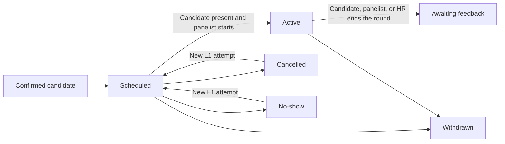

# Slice 4 implementation plan

HR can book a confirmed candidate for L1 from any drive, assign a verified panelist, and copy one Studio link into a Teams invitation. The candidate verifies their mailbox and waits for the assigned panelist to start the round. Either participant can end the active round. The round then awaits feedback, and candidate access ends immediately. Prove the complete flow with synthetic users on the local Mac stack. [Requirements roadmap](../core/requirements-roadmap.md#4-schedule-a-round-and-admit-the-candidate) · [Product plan](../core/product-plan.md#scheduling-invitations-and-session-access)

## Approved decisions and slice boundaries

| Decision | Behavior |
| --- | --- |
| HR workspace | Add **Interviews** alongside **Dashboard** and **Drives**. Show eligible confirmed candidates across drives using the existing candidate records. |
| Panelist selection | List verified staff with the current **Panelist** role. Assign one person per round. L1 and L2 identify assignments on an ordinary panelist account. |
| Round order | Ship L1 booking in Slice 4. Slice 5 adds assessment submission and exposes **Schedule L2** only after a submitted L1 **Pass**. Ending L1 places the attempt in **Awaiting feedback**. |
| Scheduling defaults | Start each HR account with India Standard Time (`Asia/Kolkata`) and 60 minutes. Change the defaults in **Settings**. Booking shows the effective zone beside the local date and time and allows a duration override. |
| Meeting details | Virtual booking can proceed while the Teams URL is pending. HR can add it later. In-person booking requires a room. |
| Invitation | Studio generates one shared round link and copyable text. HR sends the Teams invite or shares the text through their usual channel. Studio sends the candidate verification code when the candidate requests it. |
| Candidate identity | A candidate uses the invited email and a one-time mailbox code, then confirms their name and experience. Candidate access is scoped to one round and has its own session. |

Candidate email verification and attaching the Teams URL after booking refine the current product plan. Implement those approved behaviors in this slice. Keep scorecards, assessments, L2 eligibility, reporting, live code and whiteboard, and AI on their roadmap slices. Slice 4 uses a waiting room and a simple active-round screen. [Later slices](../core/requirements-roadmap.md#5-complete-l1-and-l2-manually)

## Screens and access

| Surface | Role | Contents and primary actions |
| --- | --- | --- |
| `/staff/interviews` | HR | **To schedule**, **Scheduled**, and **History**. Search candidate name or email. Filter by drive and experience. **Scheduled** covers upcoming and active rounds. **History** includes awaiting feedback and closed scheduling outcomes. |
| Booking sheet in **Interviews** | HR | Candidate name, email, experience, drive, and next round. Pick a panelist, date, time, duration, and interview mode. Show the effective zone, the calculated end time, and any conflict before booking. |
| Booking detail in **Interviews** | HR | View schedule, assignment, attendance, and status. Copy invitation, add or update meeting details, reschedule, reassign, replace the link, cancel, mark no-show, record withdrawal, or close an abandoned active round as allowed by its state. |
| `/staff/settings` | HR for scheduling preferences | Add **Interview scheduling** with default time zone and duration. Keep the existing appearance settings available to staff. |
| `/staff/my-interviews` and its round detail | Assigned panelist | Show only the panelist’s own rounds. Display candidate name, experience, drive title, time, location, and attendance. Start when the candidate is present. End an active round after confirmation. |
| `/join/<invitation-id>#<secret>` | Anyone with the link | Render a neutral entry page with **Join as candidate** and **Staff sign-in**. Keep candidate and booking details behind the corresponding authorization check. |
| `/interview/<round-id>` | Admitted candidate | Confirm details, see their own schedule and waiting or active state, and confirm ending the round when active. Show a generic ended or unavailable screen after access ends. |

- Add distinct navigation permissions for **Interviews** and **My interviews**. Directors retain their current drive overview in this slice. Candidate sessions provide access only to candidate interview endpoints. Panelists receive an assignment-specific response without drive intake data, original resume access, or a candidate directory. Resolve the current staff role and assignment on each request. [Staff routes](../../apps/server/src/staff/routes.ts) · [Staff navigation](../../apps/web/src/staff/staff-layout.tsx)
- Use server-side pagination and a stable sort for the cross-drive queue. Put search, drive, experience range, and page in URL search state so HR can return to a filter. Candidates with unknown experience remain visible when the experience filter is unset. Keep the displayed results and input focus during a debounced refresh. Use the selected drive ID for filtering and display its name. Reuse the accessible loading and sheet patterns from candidate review. [Review queue](../../apps/web/src/drives/review-queue.tsx) · [Review sheet](../../apps/web/src/drives/review-sheet.tsx)
- Use a searchable panelist dropdown with name and work email to distinguish similar names. Keep verified default-role panelists eligible even if they have no explicit grant row. Recheck who is eligible in the booking transaction. If there are no panelists, explain that a panelist must register and verify their work email. [Staff role resolution](../../apps/server/src/staff/roles.ts)
- On narrow screens the booking sheet fills the viewport and keeps its main action reachable. Preserve inputs after a conflict, stale write, or transient request failure. Return focus to the candidate row on close. Keep calendar and time inputs keyboard accessible.
- Show **Teams link pending** on a virtual booking without a meeting URL. Validate an attached meeting URL as HTTPS, reject embedded credentials, and render it as an explicit action in authorized round views. Copy invitation text with the round, start and end in the booked time zone, the Studio link, and the meeting URL or room when available.

## Eligibility, dates, and conflict handling

- Query the existing confirmed candidacy by its drive and candidate IDs. Include only records with a valid confirmed name and normalized email. Exclude drafts, duplicates, withdrawals, and candidates with a scheduled, active, or awaiting-feedback L1 attempt. A cancelled or no-show L1 remains in history and allows a fresh numbered attempt. Confirm on the server that the selected row is still eligible when saving. An L2 booking request returns a stable `round_not_eligible` error in Slice 4. [Candidate review rules](../../apps/server/src/drives/review.ts)
- Store the effective IANA time zone with the booking and UTC start and end instants in PostgreSQL. Interpret the submitted local date and time in that zone on the server using Temporal in the pinned Node runtime. Validate time zones and duration server-side. Reject nonexistent local times during a daylight-saving change and ask HR to distinguish the two offsets for a repeated time. The IST default uses the same conversion path.
- Read the caller’s scheduling preferences, including their revision, when opening the sheet. If a preference changes before submission, return the current settings and ask HR to review the intended slot. Existing bookings retain their time zone and duration. A reschedule starts with the booked zone displayed and keeps the booked duration unless HR edits it.
- Compare half-open UTC intervals `[start, end)` for the same normalized candidate email or panelist ID across drives. Back-to-back slots are valid. Check scheduled and active bookings. Include actual start if an active round started early. Treat an active round in overtime as occupied until it closes. Exclude the booking being edited and cancelled, ended, no-show, or withdrawn attempts. Return the conflict type, drive, and time window to authorized HR.
- Check overlaps when HR submits a booking or a change to its time or panelist. If conflicts exist, show **Book anyway** or **Save anyway** with the relevant conflicts. Recheck the current conflict set on confirmation and require renewed acknowledgment if the set changed. Serialize overlapping-resource checks within the write transaction so simultaneous bookings cannot both miss each other. Advisory warnings still allow distinct candidacies to be booked.
- Prevent two open L1 attempts for the same candidacy through a database constraint and a locked eligibility check. Allow normalized emails to match across different drives. Keep the candidate’s invited email as a snapshot on the round. If HR needs to change a confirmed email while a scheduled or active attempt uses it, return a specific conflict and direct HR to cancel the upcoming booking or end the active round before changing the address. Other permitted intake edits leave the round snapshot available for audit.

## Round states and access changes

| Action | Allowed state and actor | Result |
| --- | --- | --- |
| Book | HR with an eligible confirmed candidacy | Create a scheduled L1 attempt and its first invitation. |
| Update Teams URL or room | HR on a scheduled round | Update meeting details and retain the current Studio link. Show the latest details in copied text and authorized views. |
| Reassign | HR on a scheduled round | Validate the new panelist, check overlaps, and remove the former panelist’s access as soon as the change commits. Retain the candidate link and waiting session. |
| Reschedule or replace link | HR on a scheduled round, including a joined candidate waiting to start | Revoke the old invitation, outstanding challenges, and candidate sessions. Create a new invitation within the same transaction. Keep the same attempt, and prompt HR to update the Teams invite with the replacement link. |
| Cancel | HR on a scheduled round | Revoke access, retain the attempt in history, and allow a fresh L1 booking. |
| Mark no-show | HR after the scheduled end of an unstarted round | Record who was absent and a short reason. Revoke access, retain the attempt, and allow a fresh booking. |
| Withdraw | HR on a confirmed candidacy before a booking or during a scheduled or active round | Record the candidacy withdrawal and reason. Mark any open scheduled or active attempt withdrawn and revoke its access. Exclude the candidacy from subsequent booking. |
| Start | Assigned panelist while the round is scheduled, within the entry window, with a verified candidate recently present | Atomically move to **Active** and record who started it and when. |
| End | Admitted candidate or assigned panelist on an active round, or HR closing an abandoned active round | Confirm the action, move to **Awaiting feedback**, and revoke the invitation and candidate session in the same transaction. Preserve the round and attendance history. |

Recheck transitions server-side with the current revision. If candidate closure committed and its response was lost, let the same revoked session and command key receive a generic completion acknowledgment for that exact command. All other reads and writes stay revoked. Show a generic ended state when access is revoked. Record scheduling outcomes separately from assessment decisions. [Round lifecycle](../core/product-plan.md#scheduling-invitations-and-session-access)

## Shared invitation and candidate admission

### 1. Generate, copy, and resolve the link

- Give every invitation an opaque random UUID. Put the secret in the URL fragment so it stays out of HTTP paths, query strings, and ordinary request logs. Construct the URL from the configured Studio origin. Copy the link on demand from the HR booking detail, including after a reload.
- Derive the invitation secret from its random ID using a dedicated server-side key and a purpose-specific HMAC. Store its hash with the invitation. Reconstruct the same secret for authorized HR copying and compare its hash on candidate requests. Give each replacement a new ID and secret. Define rotation in the local configuration notes so scheduled links are deliberately replaced if the key changes.
- The entry page captures the fragment in memory and removes it from the URL. The candidate path submits it in the admission request body. The staff path carries only the public invitation ID through staff sign-in and resolves it after session and assignment checks. Use a typed invitation ID for the sign-in continuation and build the destination within the application. [Existing sign-in flow](../../apps/web/src/staff/auth-pages.tsx) · [Route tree](../../apps/web/src/main.tsx)
- Show a clear reopen-the-invite message if a candidate opens a URL with a missing fragment or refreshes before admission. After admission, the round page relies on the candidate session. Use `Cache-Control: no-store` for private responses and `Referrer-Policy: no-referrer` for entry and round pages. Test the full link after copy and paste through the Teams invite workflow, including whether the browser receives the fragment.

### 2. Verify the invited mailbox

- Check the current invitation, scheduled or active state, normalized invited email, and entry window before sending a code. The window is `start − 10 minutes` inclusive through the scheduled end exclusive. Use a generic denial for the wrong email, invalid secret, or revoked invite. Deny entry outside the window and provide timing guidance after validating the invitation.
- Generate a cryptographically random six-digit code. Store a keyed digest bound to the challenge and invitation, with an expiry of 10 minutes or scheduled end, whichever comes first. Make successful verification single-use. Start with five attempts per challenge, a 60-second resend cooldown, and up to three sends per invitation in 15 minutes. Use shared database-backed counters across app instances and apply a trusted-source rate limit to public challenge endpoints. Reissuing a code preserves the per-invitation budget.
- Reserve the challenge under a lock before sending. Deliver it via the existing SMTP transport outside the database transaction. Add an awaitable mail path so the UI can distinguish an accepted send from a temporary transport failure. Finish or expire pending challenges so a failed send can be retried. Serialize resends and verification, and reject stale challenges even if an email arrives after revocation. Reuse Mailpit locally and the existing staff mail behavior. [Mailer](../../apps/server/src/staff/mailer.ts)
- Check the code and the current invitation in one transaction. Consume the challenge and create the attempt-scoped candidate session atomically. A new verified session replaces the earlier session if the candidate switches browsers during the entry window. Only after verification, show the candidate’s name and experience to confirm. Keep experience optional if unknown. Store any correction on the round’s attendance record. The HR intake record remains the scheduling source.

### 3. Admit, start, reconnect, and end

- Use a separate opaque candidate session with a hash at rest, an HTTP-only cookie scoped to that attempt’s candidate API, and the same explicit loopback exception as staff for local development. Require HTTPS and secure cookies on a shared host. Confirm details before the session can register candidate presence. Keep admission and scheduling deadlines on the server.
- Candidates report presence while in the waiting room through a short polling heartbeat. Start with an eight-second interval and a 30-second freshness window. The assigned panelist sees **Waiting for candidate** or **Candidate connected**. Recheck recent verified presence when starting, even if the rendered button was enabled. Stop polling on end, sign-out, or leaving the screen and back off on transient errors.
- Before start, stop waiting-room access at the scheduled end. After start, allow the already-admitted candidate to reconnect in the same browser during overtime. New first entry still uses the scheduled window. Refreshes and disconnected tabs preserve the active round. Keep presence writes separate from the booking revision.
- Check the round, current invitation, session, and applicable time rule on every candidate request. Closing or revoking the round blocks further data access and new actions immediately. The Slice 4 UI learns the change on its next poll. Slice 7 will use the same access rules to disconnect live connections and deny later messages. [Session architecture](../core/architecture.md#modules-access-and-stored-records)

## Data and contracts

Use additive Drizzle migrations. Register schemas in the existing server schema barrel and export scheduling contracts from the shared package. Keep the slice in an `interviews` feature module with separate staff and candidate routes and explicit response schemas. [Server schema](../../apps/server/src/schema.ts) · [Shared contract exports](../../packages/contracts/src/index.ts)

| Record | Essential data and constraints |
| --- | --- |
| HR scheduling preference | One row per staff ID with validated IANA zone, default duration, and revision. Supply the agreed defaults for accounts without a row. |
| Interview round | ID, drive and candidate IDs, round level, attempt number, assigned panelist ID, invited email and profile snapshot, UTC start and end, zone, duration, mode, Teams URL or room, state, revision, and actor timestamps. Use a composite reference to the scoped candidate, unique attempt numbers per candidate and level, and a partial unique index for an unresolved attempt. Index panelist and invited email with scheduling times for conflict reads. |
| Candidacy withdrawal | One row per candidacy with actor, time, and reason. Allows withdrawal before any booking and preserves drive scoping. |
| Invitation | Public UUID, attempt ID, purpose-specific secret hash, generation, creation, and revocation metadata. Enforce one current invitation per attempt. |
| Admission challenge | Invitation, keyed code digest, expiry, delivery phase, attempts remaining, and consumption or revocation time. Keep send budgets bounded and expire challenge data after it is useful. |
| Candidate session and attendance | Attempt and invitation IDs, session hash, admission and revocation timestamps, profile confirmation, and last presence timestamps. Enforce one current session per attempt. Keep a single round attendance record and preserve previously confirmed details when a candidate reconnects. |
| Interview event and command receipt | Append meaningful changes with the actor, action, target, time, and relevant revisions. Store an idempotency key, normalized request fingerprint, and resulting resource identifiers for retriable writes. Keep secrets, codes, message content, and personal detail out of logs and receipts. |

- Use a consistent lock order for writes that touch the candidate, staff role, scheduling resources, round, and admission records. Serialize candidate eligibility on the candidate row used by drive review. Synchronize assignment checks with the existing staff user lock used for role changes. Lock affected email and panelist scheduling keys in sorted order before rechecking overlaps. For an edit, include the old and new resource keys. Reload authoritative rows under the locks before applying writes.
- Use revision checks for preferences and each round mutation. Accept a stable idempotency key for booking and lifecycle commands. A retry of the same command returns its existing result when the caller still has access. Reusing a key with different values fails. A stale revision returns the latest authorized state for the UI to inspect. Never create a second booking or rotate a link twice on a retry.
- Enforce origin checks on writes, bound bodies and list queries, and shape responses separately for HR, panelist, and candidate. Return `401` for unauthenticated routes, `403` for a denied staff role, and a scoped `404` for a resource unavailable to an otherwise authorized caller. Admission uses generic errors where a detailed response would disclose candidate identity. Use stable codes for conflicts, stale revisions, invalid transitions, and throttling.

## Endpoint groups

| Prefix | Actions |
| --- | --- |
| `/api/staff/interviews` | List eligible candidates and rounds, list eligible panelists, book a round, inspect and manage a round, and retrieve the current invitation for copying. Scope candidate lookups to their drive. |
| `/api/staff/settings/interviews` | Read and update the caller’s scheduling preferences. |
| `/api/staff/my-interviews` | List assigned rounds, resolve a current invitation ID after staff sign-in, read assigned round state, and start or end an assigned round. |
| `/api/interviews/invitations/<id>` | Request or resend the email code and exchange a valid code for an attempt-scoped session. Validate invitation secrets in request bodies. |
| `/api/interviews/rounds/<id>` | Read the candidate’s own round, confirm details, report presence, and end the active round. |

Mount staff routes behind the existing verified role and origin middleware. Mount candidate endpoints with their own origin and session checks before the generic API fallback. Add the corresponding public and staff page paths to the Hono SPA allowlist and the lazy route tree. [Application entry point](../../apps/server/src/main.ts) · [Staff middleware](../../apps/server/src/staff/routes.ts) · [Web routes](../../apps/web/src/main.tsx)

## Build order

1. **Add storage and shared contracts.** Define the transitions and authorization rules in the interview service, plus the additive migrations. Add scheduling preference reads and writes. Add a dedicated `STUDIO_INTERVIEW_SECRET` through local init and Compose, preserving older local environment files and restricting the key to the app service. Test date conversion, constraints, and transition rules before wiring screens.
2. **Deliver HR booking.** Build the confirmed-candidate query and panelist lookup, then booking, overlap confirmation, revisions, and idempotency. Build **Interviews**, **Settings**, and the booking sheet. Test a real confirmed candidate from Slice 3 flowing into scheduling.
3. **Generate the link and deliver admission.** Add authorized copying, the shared entry page, staff sign-in continuation, SMTP codes, and candidate sessions. Exercise early arrival, invalid or expired codes, the correct email, and replay in separate contexts before relying on the waiting room.
4. **Deliver assigned rounds and lifecycle operations.** Build **My interviews**, start and end, waiting-room presence, and the remaining HR management actions. Reuse the same revocation transaction across reschedule, cancellation, replacement, no-show, withdrawal, and closure. Test access on both the old and new state after every write.
5. **Run the local rehearsal.** Add repeatable synthetic fixtures with a confirmed candidate, assigned and unrelated panelists, and an overlapping booking in another drive. Run migrations on fresh and existing local data. Rehearse the complete path through separate HR, panelist, and candidate browser contexts with Mailpit. Update the roadmap checkbox after acceptance passes.

## Acceptance matrix

| Check | Required evidence |
| --- | --- |
| Eligibility | A newly confirmed candidate appears in **To schedule** without reimporting the resume. A draft, duplicate, withdrawal, and candidate already booked for L1 are excluded. Searching and pagination work across several drives. A premature L2 request is denied. |
| Defaults and time conversion | A new HR account gets IST and 60 minutes. A preference change affects that account’s next booking. Duration can be overridden. Existing booked times survive a settings change. Cover ambiguous and nonexistent local times in a daylight-saving zone. |
| Panelist permissions | Only verified, currently eligible panelists are selectable. A role change between loading and booking is rejected. An unrelated panelist and a director cannot open interview details or candidate endpoints. Reassignment removes the former panelist’s access while the new assignee can open the round. |
| Cross-drive overlaps and concurrent writes | Detect an overlapping normalized email and a panelist conflict separately across drives. Allow an explicit override and permit back-to-back slots. Run simultaneous booking attempts and verify the second sees the conflict or loses same-candidacy uniqueness. A retry after a dropped response returns the original booking. |
| Shared invitation | HR can copy the identical current link after refreshing. The link opens the entry page for both people. Staff sign-in returns the assigned panelist to the correct round. Candidate details appear only after mailbox verification. Virtual booking and link copying work before the Teams URL is added. |
| Candidate entry | Verify the ten-minute boundary, scheduled-end boundary, wrong email, bad or expired code, resend limits, delivery failure, code replay, and a correct code received in Mailpit. Confirming details makes the candidate present for the assigned panelist. Candidate sessions cannot access another round or staff routes. |
| Presence and overtime | Start fails before a candidate is present or when the heartbeat is stale. A legitimate start transitions both screens to **Active**. An admitted browser refreshes or reconnects after scheduled end while active. A new admission after scheduled end fails. |
| Revocation and operation history | Exercise reschedule, link replacement, cancellation, no-show, withdrawal, and closure. Old links, challenges, and sessions lose the applicable access. Two clicks on the same action preserve one transition. Cancelled and no-show attempts remain in history and can be rebooked. Withdrawal closes eligibility. |
| Close and handoff | Candidate, assigned panelist, and HR can each close an active round through their authorized path. Closing makes the next candidate API call fail immediately. HR and the assignee see **Awaiting feedback**. Candidate details and round history remain available only to the authorized staff views. |
| Upgrade, UI, and rehearsal | Migrate existing drive and staff data, seed twice, and restart the app with a valid booking. Verify keyboard use, sheet focus, mobile layout, and search with delayed responses. Run `pnpm check`, `pnpm test` with isolated PostgreSQL, and `pnpm test:browser` with isolated Compose and Mailpit. |

Use fake-clock or controlled persisted times for entry windows, code expiration, and overtime checks. Use actual database transactions for overlap and concurrent-write tests. Keep browser tests synthetic, keep Mailpit on loopback, and inspect logs for successful stage identifiers without secrets or email contents. A shared-host rehearsal also verifies that the configured HTTPS Studio origin is reachable by both participants and that the full invitation survives the Teams copy-and-open path. [Local verification commands](../../README.md)
